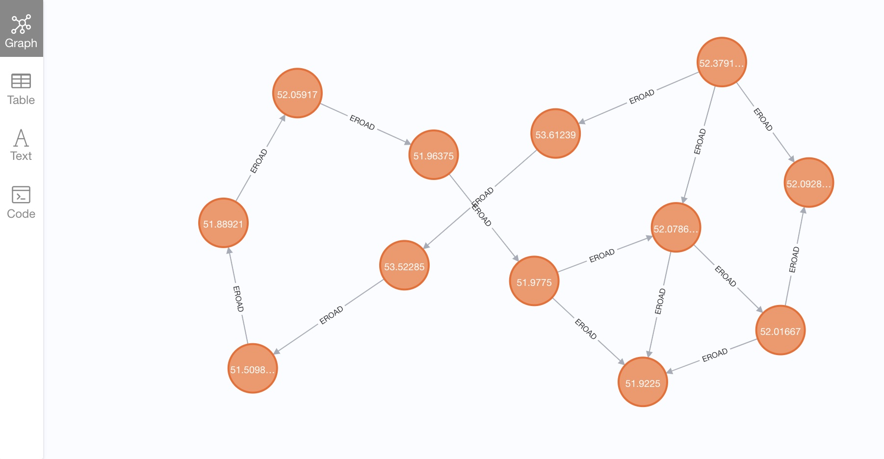

# 基于 `Spark` 与 `Neo4j` 的分布式图数据分析

这个项目整理了学习分布式计算和图数据库过程中的一些实践，包括 `Hadoop`、`Hive`、`Spark` 以及 `Neo4j` 的使用。

## 技术栈

### 基础设施

- **`Hadoop`**: 分布式计算平台，核心是 `HDFS` 和 `MapReduce`，用来存数据和跑计算任务
- **`Docker`**: 用来快速搭环境，省得手动配置

```bash
# 启动Hadoop
docker run -p 50070:50070 -p 9000:9000 -p 8088:8088 -it sequenceiq/hadoop-docker /etc/bootstrap.sh -bash
```

### 数据存储

- **`Neo4j`**: 图数据库，用来存图结构的数据，配合 `APOC` 和 `Graph Algorithm` 插件挺好用的

```bash
# 启动Neo4j
docker run -d --name neo4j_db -p 7474:7474 -p 7687:7687 \
  -v /tmp/neo4j/data:/data -v /tmp/neo4j/logs:/logs \
  -v /tmp/neo4j/conf:/var/lib/neo4j/conf \
  -v /tmp/neo4j/import:/var/lib/neo4j/import \
  -v /tmp/neo4j/plugins:/plugins \
  --env NEO4J_AUTH=neo4j/password neo4j
```

- **`Hive`**: 基于 `Hadoop` 的数据仓库，用 `SQL` 查询挺方便的

### 计算框架

- **`Apache Spark 3.0`**: 分布式计算引擎
- **`PySpark` + `GraphFrames 0.8`**: `Python` 版的图计算
- **`Databricks`**: 定制 `Spark SQL` 扩展

## 主要内容

### 1. 图数据导入

把 CSV 格式的节点和边数据导入 `GraphFrames` 和 `Neo4j`，数据存在 `dataset` 文件夹下。

**Neo4j 导入示例：**

```cypher
// 导入节点
LOAD CSV WITH HEADERS FROM "file:/data/social-nodes.csv" AS row
MERGE (place:User {id: row.id})

// 导入关系
LOAD CSV WITH HEADERS FROM "file:/data/social-relationships.csv" AS row
MATCH (source:User {id: row.src})
MATCH (destination:User {id: row.dst})
MERGE (source)-[:FOLLOWS]->(destination)
```

**GraphFrames 导入示例：**

```python
from pyspark_graph.import_graph import create_transport_graph

graph = create_transport_graph(spark)
```

导入效果：



### 2. 图算法

这部分是学习的重点，包括：

#### 中心性算法（`Centrality`）

| 算法 | 作用 |
|------|------|
| 度中心性（`Degree Centrality`） | 数一下每个节点有多少条边连出去 |
| 接近中心性（`Closeness Centrality`） | 看一个节点到其他节点的平均距离远近 |
| 中间中心性（`Betweenness Centrality`） | 找出网络中的"桥梁"节点 |
| `PageRank` | 评估节点的重要性，类似谷歌那个 |

#### 社区发现算法（`Community Detection`）

| 算法 | 作用 |
|------|------|
| 三角形计数（`Triangle Counting`） | 统计形成三角形的节点 |
| 聚类系数（`Clustering Coefficient`） | 衡量邻居节点之间是否也互相认识 |
| 强连通分量（`SCC`） | 找出相互都能到达的节点集合 |
| 标签传播（`Label Propagation`） | 通过标签传播来划分社区 |
| `Louvain` | 优化模块度来发现社区 |

#### 路径查找算法（`Path Finding`）

| 算法 | 作用 |
|------|------|
| 最短路径（`Shortest Path`） | 找两点之间的最短路 |
| `A*` 算法 | 带启发式的路径搜索 |
| `K` 最短路径 | 找出前 `K` 条最短路径 |
| 最小生成树（`MST`） | 用最小权重连接所有节点 |
| 随机游走（`Random Walk`） | 随机遍历图的路径 |

### 3. 数据分析

#### Hive SQL电影数据分析

用的是 `hive_sql_test1` 库，有 `t_user`（6000+用户）、`t_movie`（3000+电影）、`t_rating`（100万+评分）三张表。做了些有意思的分析：

- 按年龄段统计某部电影的评分
- 找出男性评分最高的10部电影

#### `Spark SQL` 优化规则

学习 `Catalyst` 优化器时自己捣鼓的，包括：

- `CombineFilters`：合并过滤条件
- `CollapseProject`：折叠投影
- `BooleanSimplification`：简化布尔表达式
- `ConstantFolding`：常量折叠
- `PushDownPredicates`：谓词下推
- `ReplaceDistinctWithAggregate`：去重转聚合
- `ReplaceExceptWithAntiJoin`：`EXCEPT` 转反连接

#### 航空网络分析

基于美国航班真实数据做的分析：

- 看芝加哥 `ORD` 这种枢纽机场的延误情况
- 算各家航空公司的航线覆盖
- 找异常航班模式

